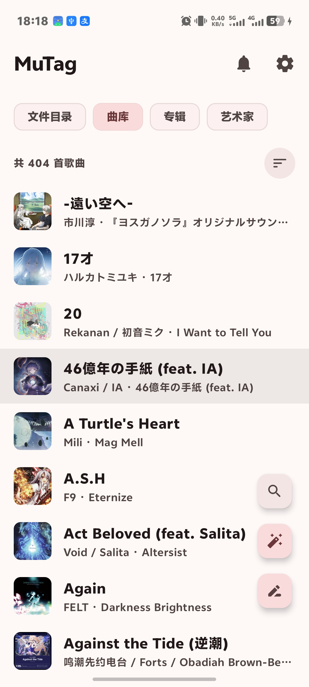
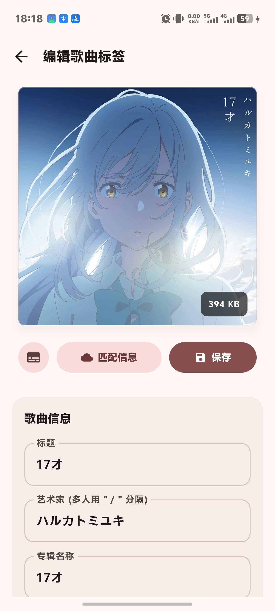
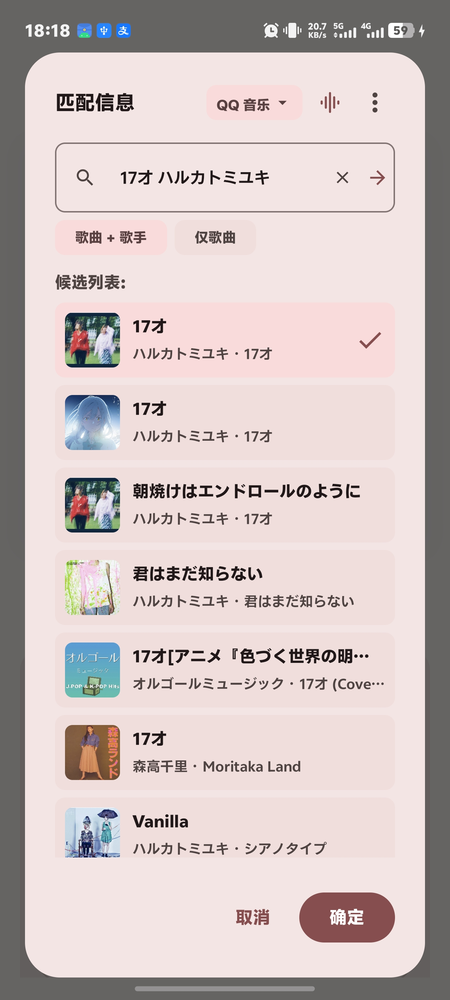

# MuTag

又一款本地音频标签编辑与元数据匹配工具。

## 元数据字段支持对比

| 字段 | QQ 音乐 | 网易云音乐 | 说明 |
| :--- | :---: | :---: | :--- |
| **标题 / 艺术家 / 专辑** | 支持 | 支持 | 基础元数据 |
| **封面图片** | 支持 | 支持 | 高清专辑封面 |
| **逐行歌词** | 支持 | 支持 | 支持翻译合并
| **发行日期** | 支持 | 支持 | YYYY-MM-DD |
| **音轨号 / 总音轨** | 支持 | 部分支持 | 网易云部分单曲可能无总音轨数 |
| **碟号 (Disc)** | 支持 | 不支持 | 网易云默认填 1 |
| **唱片公司** | 视曲目而定 | 视曲目而定 | 独立音乐人或部分早期曲目可能为空 |
| **词 / 曲 / 编曲 / 制作人** | 视曲目而定 | 视曲目而定 | 提取自歌词头部制作名单，视原曲而定 |
| **流派风格 (Genre)** | 视曲目而定 | 不支持 | 仅 QQ 音乐曲目详情提供 |
| **曲目语种 (Language)** | 视曲目而定 | 不支持 | 仅 QQ 音乐曲目详情提供 |
| **ReplayGain (增益/峰值)** | 视曲目而定 | 不支持 | 仅 QQ 音乐部分曲目提供音量均衡数据 |

## 界面展示

| 主界面 | 曲目编辑 | 匹配信息 |
| :---: | :---: | :---: |
|  |  |  |

## 许可证

本项目采用 [MIT 许可证](LICENSE)。
